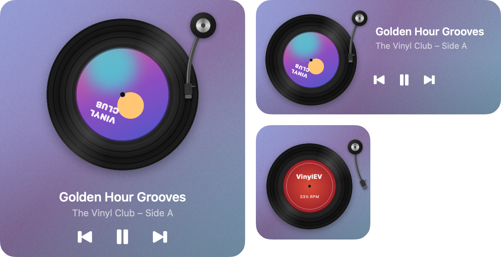

  

<h1 align="center">VinylEV</h1>

A vinyl record widget for your Mac that spins when Spotify plays.

<h3 align="center">
  <a href="https://github.com/MilkshakeEV/VinylEV/releases/latest/download/VinylEV.dmg">⬇︎ Download VinylEV</a>
</h3>

<a href="https://github.com/MilkshakeEV/VinylEV/releases/latest/download/VinylEV.dmg">VinylEV.dmg</a> · always the newest version

  

## Requirements

- Any Mac, Apple silicon or Intel
- macOS 14 Sonoma or newer
- The Spotify desktop app

## Install

1. Download **VinylEV.dmg** with the button above and open it.
2. Drag **VinylEV** onto the **Applications** folder.
3. Open it from Applications. It isn't notarized by Apple, so the first time macOS says it can't
   check it: click **Done**, then open **System Settings → Privacy & Security**, scroll to
   **Security** and click **Open Anyway** next to VinylEV. You only do this once.
4. When macOS asks whether VinylEV may control Spotify, click **Allow**.
5. Right-click the desktop → **Edit Widgets…** → search **VinylEV** and drag a size onto the
   desktop.

More detail, including what to do if the Open Anyway button doesn't appear: [INSTALL.md](INSTALL.md).

## What it shows

While Spotify plays, the album cover becomes the label of a record that turns, the tonearm rests
on the record, and the card takes its colors from the cover. Pause, and the record stops and the
arm lifts.

- **Small:** just the record and tonearm.
- **Medium:** the record, with the song, artist and album, and ⏮ ⏯ ⏭ buttons.
- **Large:** the record on top, the song and the buttons below.
- **Extra Large:** everything, plus a progress bar with elapsed and remaining time.

The widget works in full color and in the tinted / monochrome desktop style, in light and dark
mode. For album colors all the time: **System Settings → Desktop & Dock → Widget style →
Full-color**.

## Good to know

- The record turns in small steps once a second, which macOS smooths into a spin. Widgets can't
  run a continuous animation, so expect the odd tiny hitch.
- Widgets update a moment after Spotify changes, since macOS refreshes widgets on its own schedule.
- It follows the Spotify desktop app only, and never opens Spotify by itself.

## Updates

Download the new **VinylEV.dmg** and drag the app into Applications again. Your settings and the
Spotify permission are kept.

## Privacy

No accounts, no tracking, no Spotify login. VinylEV talks to the Spotify app on your Mac and
downloads album covers from Spotify's image server. Nothing else leaves your Mac.

Not affiliated with, endorsed by, or sponsored by Spotify.

[All releases](https://github.com/MilkshakeEV/VinylEV/releases)
